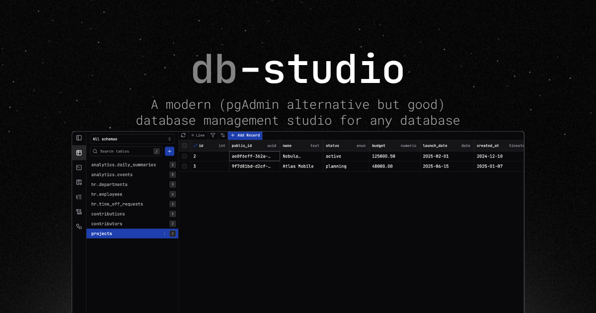

# db-studio

<p align="center">
  
</p>

<p align="center">
  <a href="https://www.npmjs.com/package/db-studio"></a>
  <a href="https://www.npmjs.com/package/db-studio"></a>
  <a href="https://github.com/husamql3/db-studio/stargazers"></a>
  <a href="LICENSE"></a>
  <a href="https://deepwiki.com/husamql3/db-studio"></a>
</p>

<p align="center">
Every database. One studio<br>
Browse tables, edit records, design schemas, and run queries from one UI, launched with a single <code>npx</code> command.
</p>

<p align="center">
  
</p>

## Installation

No installation required:

```bash
npx db-studio
```

db-studio searches the current directory, then its parents, for a `.env` file with `DATABASE_URL`, then the environment. Without one, open the printed address and paste a connection URL on the Connect page.

Every connection that opens is saved to `~/.dbstudio/connections.json`, readable only by your user, so you can switch between them from the sidebar. The server listens on `127.0.0.1` only; to serve it on your network, set `HOST` and list the hostname or IP you connect through in `ALLOWED_HOSTS`. db-studio then asks for a password: any username, and the password printed at startup or set in `DB_STUDIO_PASSWORD`.

You can also run `db-studio` as a Docker container. Simply run:

```bash
docker build -t db-studio .
docker run --rm -p 127.0.0.1:3333:3333 -v db-studio-config:/home/node/config db-studio
```

Check [Running db studio with Docker](https://dbstudio.sh/docs/docker) to learn more and customize the container.

**As a project script:**

```json
{
	"scripts": {
		"db:studio": "npx db-studio"
	}
}
```

**Flags:**

| Flag                       | Description                                   | Example                                          |
| -------------------------- | --------------------------------------------- | ------------------------------------------------ |
| `-e, --env <path>`         | Use a specific `.env` file                    | `npx db-studio --env .env.local`                 |
| `-n, --var-name <name>`    | Read a different environment variable         | `npx db-studio --var-name MY_DB_URL`             |
| `-p, --port <number>`      | Change the server port (default: 3333)        | `npx db-studio --port 4000`                      |
| `-d, --database-url <url>` | Pass the connection string directly           | `npx db-studio -d "postgresql://localhost/mydb"` |
| `--open`                   | Open db-studio in your browser once it starts | `npx db-studio --open`                           |
| `--no-open`                | Do not open the browser (the default)         | `npx db-studio --no-open`                        |
| `-s, --status`             | Check the connection only, without the UI     | `npx db-studio --status`                         |
| `-v, --version`            | Show the installed version                    | `npx db-studio --version`                        |
| `-h, --help`               | Show all options                              | `npx db-studio --help`                           |

Full documentation: [dbstudio.sh](https://dbstudio.sh)

## Features

### Databases

- 🐘 PostgreSQL, CockroachDB, MySQL, MariaDB, TiDB, SQL Server, Oracle
- 🪶 SQLite, Turso / libSQL, Cloudflare D1, DuckDB
- 🍃 MongoDB, Redis, ClickHouse
- 🔌 Connect with a single connection URL

### Table Browser

- 📋 Spreadsheet-like grid with inline cell editing
- 🔎 Filter, sort, and paginate rows
- 🔴 Live mode refreshes the grid and highlights changed rows and cells
- 🧾 Row details sheet with keyboard navigation between rows
- 🙈 Hide and reorder columns, saved per table
- 📤 Export tables as CSV, Excel, or JSON

### Records

- ➕ Add records with type-aware forms
- 📥 Bulk insert from CSV, Excel, or JSON
- 🔗 Pick foreign key values from the referenced table
- 🗑️ Delete rows, with force delete for dependent rows

### Schema

- 🏗️ Create and rename tables, with foreign keys
- ✏️ Add and edit columns
- 📇 Create and drop indexes

### Query Runner

- ⌨️ Monaco-powered editor with syntax highlighting and autocomplete
- ✨ Generate, optimize, or fix queries with AI

### AI Assistant

- 💬 Ask questions about your data in plain English
- 🔑 Bring your own key for Gemini, OpenAI, Anthropic, Grok, or OpenRouter

### Everywhere

- ⌘ Command palette to jump to tables and run actions
- 🌗 Light and dark themes
- 📊 Anonymous usage data, off with `DB_STUDIO_TELEMETRY=0`

## Contributing

See [CONTRIBUTING.md](CONTRIBUTING.md) for development setup. Check the [roadmap](https://dbstudio.sh/roadmap) and [changelog](https://dbstudio.sh/changelog) for what's planned and what shipped.

## License

Apache License 2.0 - see [LICENSE](LICENSE).
